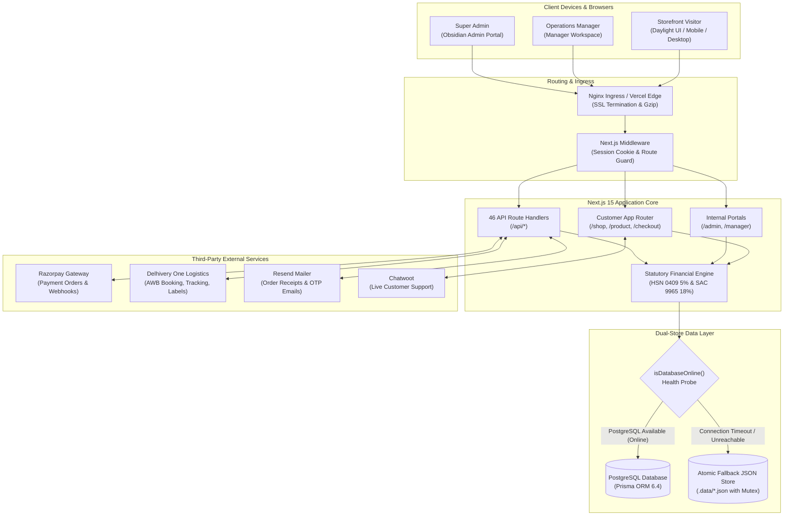
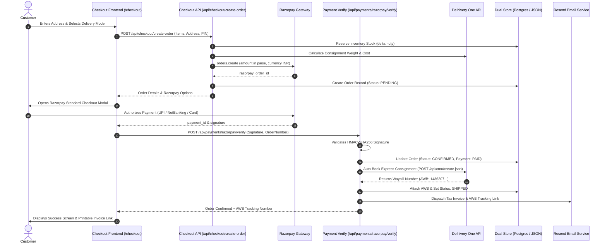
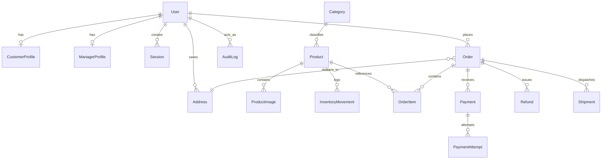

# GANESH HONEY WEB APP — COMPREHENSIVE PROJECT AUDIT & SYSTEM ARCHITECTURE REPORT

> **Document Classification**: System Architecture, Technical Audit, Codebase Specification & AI Hand-off  
> **Target Audience**: Senior Engineers, Solutions Architects, and External AI Assistants (ChatGPT / Claude / Gemini)  
> **Project Name**: Ganesh Honey Web App (`solid-glass-ecommerce`)  
> **Audit Timestamp**: 2026-11-20T13:57:00+05:30  
> **Status**: Verified via Live Static Build (69 Routes) & Complete Unit Test Suite (19 Test Suites, 143 Unit Tests Passing)

---

## 1. Executive Summary

**Ganesh Honey** (`solid-glass-ecommerce`) is a specialized, production-ready, full-stack direct-to-consumer (D2C) e-commerce web application engineered with **Next.js 15.2 (Turbopack, App Router)**, **React 19**, **TypeScript 5.7**, **Tailwind CSS 3.4**, and **Prisma ORM 6.4**. 

The brand's core commercial proposition is the distribution of single-origin, raw, unheated, cold-extracted monofloral and wild forest honey sourced from the Western Ghats and Himalayan regions of India. The brand differentiates itself through:
1. **Zero Microplastic Leaching**: Packaging exclusively in heavy food-grade solid glass jars (300g, 750g, 1050g) and comb slabs, utilizing shock-proof 5-ply cushioned transit packaging with a 100% breakage replacement guarantee.
2. **Certified Purity**: Rigorous batch testing verified via German 400MHz Nuclear Magnetic Resonance (NMR) spectroscopy and isotope ratio mass spectrometry (IRMS) to guarantee zero adulteration, inverted sugars, or added C4/C3 syrups.

### System Architecture Highlights
The codebase features a robust, resilient multi-tier architecture designed to survive database cold starts, network partitions, and serverless edge timeouts:
* **Dual-Store Resilience Engine**: The application utilizes a hybrid database layer. When PostgreSQL (managed via Prisma) is connected, all operations persist to relational tables. If the database connection drops or times out (>150ms in testing, >250ms in local dev, >1500–2500ms in production), read/write pipelines seamlessly fallback to disk-persisted atomic JSON storage (`.data/*.json`) via `src/lib/storage/json-store.ts`. This ensures customer orders, inventory reservations, staff registries, and shipping settings are never lost.
* **Three Dedicated Portals**:
  1. *Customer Daylight Storefront*: (`/`, `/shop`, `/product/[slug]`, `/cart`, `/checkout`, `/account`, `/support`, `/invoice/[orderNumber]`) featuring an organic, amber-toned visual aesthetic.
  2. *Obsidian Dark Admin Command Center*: (`/admin`, `/admin/orders`, `/admin/inventory`, `/admin/managers`, `/admin/coupons`, `/admin/reports`, `/admin/settings`, `/admin/audit-logs`) styled with high-contrast glassmorphic dark UI.
  3. *Manager Operations Desk*: (`/manager`, `/manager/orders`, `/manager/inventory`, `/manager/coupons`, `/manager/reports`, `/manager/settings`, `/manager/support`) with granular 14-permission Role-Based Access Control (RBAC).
* **Automated Logistics**: Real-time integration with **Delhivery One** API (`https://track.delhivery.com`), featuring postal pincode serviceability checks, consignment weight-slab cost calculation, automated Airway Bill (AWB) generation upon Razorpay payment capture, reverse cancellation synchronization, and live PDF packing slip streaming.
* **Statutory Indian Financial Engine**: Full compliance with Indian Goods and Services Tax (GST) rules, splitting raw honey under HSN 0409 (5% GST: 2.5% CGST + 2.5% SGST or 5% IGST) and logistics/handling under SAC 9965 / SAC 9971 (18% GST).

---

## 2. Project Overview

* **Product Domain**: High-ticket organic artisanal food, health & wellness, direct-to-consumer e-commerce.
* **Customer Personas**: Health-conscious consumers, diabetics seeking low-glycemic natural sweeteners, fitness enthusiasts, and corporate gift buyers prioritizing verified laboratory purity and non-toxic glass packaging.
* **Internal Personas**:
  * **Super Admin**: Full platform control, credential setup, audit trail oversight, fee configuration, manager provision.
  * **Operations & Fulfillment Managers**: Inventory stock adjustments, warehouse batch reconciliation, Delhivery consignment dispatch, shipment manifest downloads, and coupon creation.
  * **Support Specialists**: Customer order lookup, Chatwoot desk integration, invoice re-issuance, and refund ticket initiation.
* **Current Operational Status**:
  * Build pipeline: **100% Green** (69 routes statically compiled / server rendered).
  * Automated testing: **100% Green** (19 test files, 143 unit tests passing in ~4.7s).
  * Repositories: Sharded into three dedicated remote targets (Main monolith, VPS-hardened deployment, and Vercel-optimized serverless).

---

## 3. Complete Technology Stack

| Layer | Technology | Version | Purpose & Rationale |
| :--- | :--- | :--- | :--- |
| **Framework** | Next.js (App Router, Turbopack) | `^15.2.0` (Turbopack `15.5.28`) | Hybrid SSG/SSR/Edge rendering, dynamic server API route handlers. |
| **Runtime / Library** | React | `^19.0.0` | React Server Components (RSC), Concurrent rendering hooks (`useActionState`, `useOptimistic`). |
| **Language** | TypeScript | `^5.7.3` | Strict type safety, shared domain interfaces between backend and frontend. |
| **Styling** | Tailwind CSS | `^3.4.17` | Utility-first styling, responsive break points, customized glassmorphic design system. |
| **UI Utilities** | `clsx`, `tailwind-merge`, `cva` | Latest | Deterministic conditional className merging without CSS selector collisions. |
| **Icons** | Lucide React | `^1.16.0` | Tree-shakable clean SVG UI iconography. |
| **Forms & Validation**| React Hook Form + Zod | `^7.54.2` / `^3.24.2` | High-performance uncontrolled form inputs with schema-validated type coercion. |
| **Charts** | Recharts | `^2.15.1` | SVG-based responsive analytics visualizations for sales velocity and inventory forecasts. |
| **Database ORM** | Prisma ORM | `^6.4.0` | Type-safe query builder, migration engine, and PostgreSQL introspection. |
| **Primary Database** | PostgreSQL | 15 / 16 | Relational data persistence, foreign key integrity, ACID transactions. |
| **Fallback Storage** | Atomic JSON File Store | Custom (`fs/promises`) | In-memory mutex locked, atomic rename fallback persistence in `.data/`. |
| **Payment Gateway** | Razorpay Node SDK | `^2.9.5` | Standard Indian checkout (UPI, Cards, NetBanking), HMAC-SHA256 webhook verification. |
| **Logistics / Carrier**| Delhivery One API | REST / v1.2 | Direct integration for express parcel booking, reverse pickups, and live tracking. |
| **Transactional Email**| Resend SDK | `^6.34.1` | Modern HTTP-based transactional mailer for order confirmations and OTP dispatch. |
| **Customer Support** | Chatwoot | Live Widget | Embedded customer live chat widget synchronized with store settings. |
| **Testing Harness** | Vitest | `^3.0.5` | Ultra-fast unit and integration testing with native ESM support. |
| **Process Manager** | PM2 | `^5.4` | Cluster management, zero-downtime reloads, and daemonization on standalone VPS. |
| **Containerization** | Docker & Docker Compose | Multi-stage | Alpine Node.js 20 build container with unprivileged user security. |

---

## 4. GitHub Repository Analysis

To support divergent deployment topologies (Self-hosted Linux VPS vs. Serverless Vercel Edge), the codebase has been structured across three repositories:

### 1. Main Monorepo (Development Base & Vercel Sync)
* **GitHub URL**: [https://github.com/daddyc00l69/ganesh-mule](https://github.com/daddyc00l69/ganesh-mule)
* **Branch**: `main`
* **Role**: Primary development workspace. Connected directly to production Vercel automatic deployments (`https://ganesh-mule.vercel.app`).
* **Key Configuration**: Contains standard `next.config.mjs`, fallback storage mechanisms, and full Vitest suite.

### 2. Standalone VPS Production Repository
* **GitHub URL**: [https://github.com/daddyc00l69/ganesh-mule-vps](https://github.com/daddyc00l69/ganesh-mule-vps)
* **Local Working Copy**: `C:\Users\umarf\OneDrive\Documents\Desktop\ganesh-mule-vps`
* **Role**: Self-hosted Linux VPS deployment.
* **VPS Features**:
  * Multi-stage production `Dockerfile` (Node 20 Alpine).
  * `docker-compose.yml` pre-configured with persistent named volumes (`.data`, `.next/cache`).
  * `ecosystem.config.cjs` for bare-metal PM2 cluster mode (fork/cluster on port 3001).
  * Nginx reverse proxy configuration (`deploy/nginx-ganesh-honey.conf`) with SSL termination, Gzip/Brotli compression, rate limiting (`limit_req_zone`), and WebSocket support.
  * Systemd automated backup script (`deploy/backup-data.sh`) running via cron to archive `.data/` snapshots.

### 3. Vercel Serverless Production Repository
* **GitHub URL**: [https://github.com/daddyc00l69/ganesh-mule-vercel](https://github.com/daddyc00l69/ganesh-mule-vercel)
* **Local Working Copy**: `C:\Users\umarf\OneDrive\Documents\Desktop\ganesh-mule-vercel`
* **Role**: Lightweight serverless edge deployment.
* **Serverless Optimizations**:
  * Automatic `prisma generate` hooks in `postinstall`.
  * Stateless OTP authentication challenge tokens avoiding serverless ephemeral container memory leaks.
  * Pure client/server-boundary decoupling in `fee-settings.ts` avoiding Node.js `fs` module compilation errors on serverless lambdas.

---

## 5. Folder and File Structure

```
M:\Ganesh Mule/
├── .data/                                # Atomic fallback JSON databases
│   ├── coupons.json                      # Coupon definitions, redemption limits & usages
│   ├── delhivery-settings.json           # Live credentials, pickup warehouse PIN & mode
│   ├── fee-settings.json                 # Delivery pricing model, platform fee & tax rules
│   ├── inventory.json                    # Stock levels, reserved quantities & low-stock alerts
│   ├── orders.json                       # Live customer orders, payment snapshots & AWB numbers
│   └── staff-registry.json               # Admin & manager profiles, scrypt password hashes & RBAC
├── deploy/                               # VPS Deployment manifests
│   ├── backup-data.sh                    # Automated JSON storage archive script
│   └── nginx-ganesh-honey.conf           # Production Nginx reverse-proxy & rate-limiting config
├── prisma/
│   ├── migrations/                       # SQL migration history
│   └── schema.prisma                     # 17 Relational database models and enums
├── public/                               # Static image assets, SVG icons, and NMR certificates
│   ├── certs/                            # 400MHz NMR spectroscopy test reports (PDF/PNG)
│   ├── icons/                            # Brand SVG logos and badge icons
│   └── images/                           # Product jar photography (300g, 750g, 1050g, comb)
├── src/
│   ├── app/                              # Next.js 15 App Router (69 compiled routes)
│   │   ├── (auth)/                       # Customer authentication routes (/login, /register)
│   │   ├── (storefront)/                 # Customer browsing routes (/, /shop, /product/[slug], /cart)
│   │   ├── account/                      # Customer profile, saved addresses & order history
│   │   ├── admin/                        # Super Admin obsidian portal & analytics
│   │   │   ├── audit-logs/               # Immutable administrative audit trail
│   │   │   ├── categories/               # Monofloral & forest category management
│   │   │   ├── coupons/                  # Discount rule engine & tracking
│   │   │   ├── customers/                # Customer lifetime spend & CRM
│   │   │   ├── inventory/                # Stock in/out logs & manual reconciliations
│   │   │   ├── managers/                 # RBAC staff account provisioning
│   │   │   ├── orders/                   # Order fulfillment & status state transitions
│   │   │   ├── reports/                  # Recharts financial and operational graphs
│   │   │   └── settings/                 # Global store preferences & carrier keys
│   │   ├── api/                          # 46 Serverless API route handlers
│   │   │   ├── account/                  # /me, /orders
│   │   │   ├── admin/                    # /managers, /setup
│   │   │   ├── auth/                     # /customer-login, /staff-login, /otp, /logout, /me
│   │   │   ├── checkout/                 # /create-order (Delhivery + Razorpay order initialization)
│   │   │   ├── coupons/                  # /validate, CRUD endpoints
│   │   │   ├── emails/                   # /logs, /test
│   │   │   ├── health/                   # /health (Liveness, database probe & JSON integrity)
│   │   │   ├── inventory/                # /adjust (Stock delta adjustment with audit logging)
│   │   │   ├── invoices/                 # /[orderNumber] (HTML/PDF printable tax invoice)
│   │   │   ├── manager/                  # /join (Invite token registration)
│   │   │   ├── managers/                 # CRUD manager accounts
│   │   │   ├── orders/                   # Order query, /[id]/assign, /[id]/transition
│   │   │   ├── payments/razorpay/        # /verify (HMAC check + Delhivery auto-ship), /refund, /failure
│   │   │   ├── pincode/                  # /[pin] (Delhivery + Postal geography resolver)
│   │   │   ├── products/                 # Product catalog CRUD
│   │   │   ├── settings/fees/            # Delivery & platform fee configurations
│   │   │   ├── shipping/delhivery/       # /cost, /serviceability, /ship, /track, /cancel, /label, /sync
│   │   │   ├── warehouse/                # /schedule, /reconcile (Daily 12:30 AM batch sync)
│   │   │   └── webhooks/razorpay/        # Idempotent payment.captured webhook listener
│   │   ├── checkout/                     # Multi-step customer checkout page
│   │   ├── invoice/                      # Printable customer tax invoice view
│   │   ├── manager/                      # Manager operations desk (/orders, /inventory, /coupons)
│   │   ├── portal/                       # Staff gateway & self-registration
│   │   ├── layout.tsx                    # Root layout importing fonts, cart context, solid-glass CSS
│   │   └── not-found.tsx                 # Custom 404 handler
│   ├── components/                       # Modular UI components
│   │   ├── admin/                        # Dark glassmorphic admin layout, tables, modal forms
│   │   ├── manager/                      # Operations workspace components
│   │   ├── storefront/                   # Navbar, footer, hero, product card, filter pills
│   │   └── ui/                           # Primitive design tokens (button, badge, modal, input)
│   ├── lib/                              # Core business logic & server libraries
│   │   ├── auth/                         # scrypt hashing, stateless HMAC sessions, OTP challenge
│   │   ├── cart/                         # Cart context & localStorage synchronization
│   │   ├── config/                       # Fee settings (split into server-only and browser-safe)
│   │   ├── constants/                    # Brand specifications, honey jar weights & GST rules
│   │   ├── db/                           # Prisma client singleton & cold-start health probes
│   │   ├── email/                        # Resend templates (Order confirmation, Dispatch, OTP)
│   │   ├── india/                        # 28 States & 8 UTs postal code and GST state code matrix
│   │   ├── inventory/                    # Dual-store inventory transaction logic
│   │   ├── orders/                       # Order state machine & persistence abstraction
│   │   ├── permissions/                  # 14-key RBAC permission definitions & evaluators
│   │   ├── shipping/                     # Delhivery One API client & consignment calculations
│   │   └── storage/                      # In-memory mutex locked JSON store (`json-store.ts`)
│   └── styles/                           # Styling assets
│       ├── globals.css                   # Tailwind v3 directives & custom utility classes
│       └── solid-glass.css               # Glassmorphic backdrop filters, border glows & styling
├── tests/                                # 19 Vitest test suites (143 unit tests)
│   └── unit/                             # All automated tests covering auth, payments, shipping, GST
├── .dockerignore
├── .env.example                          # Sanitized environment variable template
├── docker-compose.yml                    # Standalone VPS container orchestrator
├── Dockerfile                            # Production multi-stage Alpine build
├── ecosystem.config.cjs                  # Production PM2 cluster manifest
├── next.config.mjs                       # Next.js image domain whitelist & compiler configs
├── package.json                          # NPM dependencies & operational scripts
├── tsconfig.json                         # Strict TypeScript configuration
└── vitest.config.ts                      # Vitest test runner configuration
```

---

## 6. System Architecture

### High-Level Architecture Flowchart



### Order Placement & Auto-Shipment Lifecycle



---

## 7. Frontend Analysis

### Next.js App Router Structure
* **Storefront Layout**: Clean, serif-accented daylight aesthetic. Built around earth tones: Forest Amber (`#d97706`), Warm Honey (`#f59e0b`), and Unbleached Linen backgrounds (`#fafaf9`).
* **Header / Navigation**: Fixed/static responsive bar (`src/components/storefront/navbar.tsx`) showing brand identity ("Ganesh Mule"), direct navigation pills (Shop, Purity & NMR, Orders), customer account trigger, and dynamic Cart Bag pill with real-time quantity indicator.
* **Product Catalog (`/shop`, `src/components/storefront/shop-client.tsx`)**:
  * Filter pills for jar sizes: `All Sizes`, `300g`, `750g`, `1050g`, and `Raw Comb`.
  * Real-time search query matching product names, flavor notes (e.g., Acacia, Jamun, Multi-flora), and medicinal properties.
  * Sort controls: Featured, Price Low-to-High, Price High-to-Low, Purity Rating.
  * Individual product cards with high-resolution imagery, NMR 400MHz badge, weight in grams, minor unit price conversion, and instantaneous cart injection.
* **Product Detail Page (`/product/[slug]`)**:
  * High-resolution gallery displaying jar front, lid seal, and nutritional facts.
  * Purity & Lab Certificate accordion linking to real German NMR analysis reports.
  * Honey characteristics radar (Viscosity, Aroma, Sweetness, Pollen density).
  * Direct pincode serviceability calculator checking Delhivery delivery speed before adding to cart.
* **Cart Drawer & Context (`src/lib/cart/cart-context.tsx`)**:
  * Uncontrolled sliding drawer tracking item quantities, subtotal calculations, and free shipping progress bars.
  * LocalStorage synchronization with custom event dispatching (`window.dispatchEvent(new Event('storage'))`).
* **Checkout Flow (`src/app/checkout/page.tsx`)**:
  * 3-step streamlined accordion: Delivery Details, Logistics Selection, and Payment.
  * Real-time Indian pincode resolution via `/api/pincode/[pin]` auto-populating State, District, and City.
  * Dynamic calculation of delivery fees (Express Air vs. Surface) based on real consignment weight and Delhivery live rates.
  * Coupon validation input supporting percentage and flat discounts with minimum order thresholds.

---

## 8. Backend Analysis

### API Route Handlers (46 Total)

#### Customer & Account APIs
1. `GET /api/account/me`: Returns authenticated customer profile, saved addresses, and active session tokens.
2. `GET /api/account/orders`: Fetches customer order history, live shipping tracking statuses, and downloadable invoice links.

#### Authentication APIs
3. `POST /api/auth/customer-login`: Customer email/password authentication returning stateless HMAC session cookie.
4. `POST /api/auth/staff-login`: Admin and Manager authentication validating against `staff-registry.json` or `User` model using scrypt password hashes.
5. `POST /api/auth/register`: Customer account creation with automatic customer profile creation.
6. `POST /api/auth/otp/send`: Generates 6-digit numeric OTP and dispatches verification email via Resend.
7. `POST /api/auth/otp/verify`: Verifies OTP and exchanges it for an authenticated customer session.
8. `POST /api/auth/logout`: Clears the `usr_` HTTP-only session cookie.
9. `GET /api/auth/me`: Resolves current session cookie identity and RBAC role.

#### Checkout & Payment APIs
10. `POST /api/checkout/create-order`: Validates cart items, verifies stock availability, reserves inventory, creates local order record, and generates Razorpay Order ID.
11. `POST /api/payments/razorpay/verify`: Validates Razorpay HMAC-SHA256 signature, updates order to `PAID`, triggers automatic Delhivery AWB dispatch, and sends confirmation email.
12. `POST /api/payments/razorpay/failure`: Records failed payment attempts in audit history and releases reserved stock.
13. `POST /api/payments/razorpay/refund`: Initiates partial or full refunds through Razorpay API (requires `refunds.approve` permission).
14. `POST /api/webhooks/razorpay`: Idempotent webhook receiver handling asynchronous `payment.captured` and `refund.processed` events.

#### Shipping & Logistics (Delhivery One) APIs
15. `GET /api/shipping/delhivery/serviceability`: Validates destination pincode against Delhivery API, returning delivery mode (Air/Surface) and COD availability.
16. `POST /api/shipping/delhivery/cost`: Calculates exact shipment charge based on jar consignment weight slabs.
17. `POST /api/shipping/delhivery/ship`: Manual manager trigger to generate Delhivery AWB consignment.
18. `GET /api/shipping/delhivery/track`: Queries Delhivery live tracking status for a given AWB or Order Number.
19. `POST /api/shipping/delhivery/cancel`: Cancels Delhivery consignment via reverse cancellation API (`/api/p/edit`).
20. `GET /api/shipping/delhivery/label`: Streams official Delhivery PDF packing slip and shipping label directly to the browser.
21. `POST /api/shipping/delhivery/sync`: Batch updates local order statuses against Delhivery tracking states (e.g., In-Transit, Out for Delivery, Delivered, RTO).
22. `GET /api/shipping/delhivery/settings`: Retrieves or updates Delhivery API credentials, pickup warehouse pincode, and default shipping modes.

#### Inventory & Warehouse APIs
23. `POST /api/inventory/adjust`: Manual stock quantity adjustment (Restock, Damage Write-Off, Manual Adjustment) with audit actor logging.
24. `POST /api/warehouse/reconcile`: Daily 12:30 AM warehouse batch reconciliation engine comparing local physical stock against reserved and transit inventory.
25. `GET /api/warehouse/schedule`: Returns warehouse operational schedules, batch cut-off windows, and fulfillment SLA metrics.

#### Catalog & Coupon APIs
26. `GET /api/products` & `POST /api/products`: Catalog listing and product creation.
27. `GET /api/products/[id]` & `PUT /api/products/[id]`: Product updates and inventory thresholds.
28. `GET /api/categories` & `POST /api/categories`: Category management.
29. `GET /api/coupons` & `POST /api/coupons`: Coupon rule creation and active promotions list.
30. `POST /api/coupons/validate`: Validates promo codes during checkout against cart total, expiry dates, and usage limits.
31. `DELETE /api/coupons/[id]`: Deactivates promo codes.

#### Administration & Management APIs
32. `GET /api/orders`: Query orders with status, date, and customer filters.
33. `POST /api/orders/[id]/transition`: Executes order state machine transitions (`PENDING` -> `PROCESSING` -> `CONFIRMED` -> `SHIPPED` -> `DELIVERED` -> `CANCELLED`).
34. `POST /api/orders/[id]/assign`: Assigns order fulfillment ownership to specific manager.
35. `GET /api/invoices/[orderNumber]`: Generates structured statutory tax invoice data.
36. `GET /api/managers` & `POST /api/managers`: Staff management and RBAC permission assignment.
37. `PUT /api/managers/[id]`: Modifies manager permissions and department.
38. `POST /api/manager/join`: Self-service manager onboarding with cryptographic invitation token.
39. `POST /api/admin/setup`: Initial super admin bootstrapping endpoint.
40. `GET /api/settings/fees` & `POST /api/settings/fees`: Configures platform fees, free delivery thresholds, and GST rates.
41. `GET /api/emails/logs`: Audits transactional emails dispatched via Resend.
42. `POST /api/emails/test`: Sends verification test email to validate Resend SMTP credentials.
43. `GET /api/pincode/[pin]`: Fast Indian postal pincode resolver mapping PIN to State, District, and Post Office name.
44. `GET /api/health`: System health probe checking database latency, memory consumption, uptime, and fallback storage integrity.

---

## 9. Database Analysis

The database schema is structured around 17 Prisma models designed for high data integrity, strict auditability, and financial accuracy.

### Complete Model Inventory



### Key Models & Schemas

1. **`User`**: Central identity model. Roles: `ADMIN`, `MANAGER`, `CUSTOMER`.
2. **`ManagerProfile`**: Granular array of permission keys (e.g., `['orders.read', 'shipping.delhivery']`), department, and notes.
3. **`CustomerProfile`**: Customer phone, purchase history, and marketing preferences.
4. **`Product`**:
   * All monetary values (`price`, `compareAtPrice`, `costPrice`) are stored in **minor units** (Paise: 100 paise = ₹1.00 INR) to eliminate floating-point precision errors.
   * Tracks `stockQuantity` (physical inventory) and `reservedQuantity` (held in active checkout carts/pending orders).
5. **`InventoryMovement`**: Immutable audit ledger recording every inventory modification, with reason codes (`ORDER_RESERVATION`, `ORDER_FULFILLMENT`, `ORDER_CANCELLATION`, `MANUAL_ADJUSTMENT`, `RESTOCK`, `DAMAGE_WRITE_OFF`).
6. **`Order`**:
   * Tracks financial breakdown: `subtotal`, `shippingCost`, `taxAmount`, `discountAmount`, `totalAmount` (all in minor units).
   * Holds historical snapshot JSON `shippingAddress` so future customer profile address changes do not alter historic invoices.
   * State machine governed by `OrderStatus` (`PENDING`, `PROCESSING`, `CONFIRMED`, `SHIPPED`, `DELIVERED`, `CANCELLED`, `RETURN_REQUESTED`, `RETURNED`) and `PaymentStatus` (`CREATED`, `PENDING`, `AUTHORIZED`, `PAID`, `FAILED`, `REFUND_PENDING`, `PARTIALLY_REFUNDED`, `REFUNDED`).
7. **`Payment` & `PaymentAttempt`**: Stores `razorpayOrderId`, `razorpayPaymentId`, currency (`INR`), and raw gateway JSON response for cryptographic audit.
8. **`Shipment`**: Links order to carrier (`DELHIVERY`), `trackingNumber` (AWB), and delivery timestamps.
9. **`AuditLog`**: Central security log tracking every administrative action (`action`, `entityType`, `entityId`, `ipAddress`, `metadata`).
10. **`StoreSettings`**: Singleton record holding store configuration, tax rates (18.0% standard), default shipping rate (₹50.00), free shipping threshold (₹999.00), and Chatwoot toggles.

### Fallback JSON Storage Schema (`.data/`)
When PostgreSQL is offline, `src/lib/storage/json-store.ts` coordinates atomic reads and writes with mutex locking:
* `orders.json`: Array of serialized order objects including shipping address snapshots and Delhivery AWBs.
* `inventory.json`: Key-value map of SKU / Product ID to stock counts.
* `staff-registry.json`: JSON dictionary of admins and managers with scrypt password hashes and permissions.
* `delhivery-settings.json`: Configuration for live carrier keys and pickup warehouse.
* `coupons.json`: Active coupon definitions and redemption history.

---

## 10. API Documentation (Core Route Table)

| Method | Endpoint | Auth Required | Permissions | Description |
| :--- | :--- | :--- | :--- | :--- |
| `POST` | `/api/checkout/create-order` | Optional (Guest Checkout) | None | Initializes order and Razorpay order ID. |
| `POST` | `/api/payments/razorpay/verify` | None (Public / Callback) | None | Validates HMAC signature and books Delhivery AWB. |
| `POST` | `/api/payments/razorpay/refund` | Staff Session | `refunds.approve` | Executes gateway refund. |
| `GET` | `/api/pincode/[pin]` | None | None | Resolves postal district, city, state. |
| `POST` | `/api/shipping/delhivery/ship` | Staff Session | `orders.update` | Dispatches parcel via Delhivery One. |
| `GET` | `/api/shipping/delhivery/label` | Staff Session | `orders.read` | Streams Delhivery packing slip PDF. |
| `POST` | `/api/shipping/delhivery/cancel` | Staff Session | `orders.update` | Cancels shipment via `/api/p/edit`. |
| `POST` | `/api/inventory/adjust` | Staff Session | `inventory.update` | Adjusts stock with reason codes. |
| `POST` | `/api/orders/[id]/transition` | Staff Session | `orders.update` | Transitions order lifecycle status. |
| `GET` | `/api/invoices/[orderNumber]` | Public / Verified Cookie | None / Order Owner | Renders GST tax invoice HTML. |
| `GET` | `/api/health` | None | None | Returns database latency, uptime, memory. |

---

## 11. Feature-by-Feature Documentation

### Feature 1: Customer Storefront & Filtering
* **Location**: `src/app/(storefront)/page.tsx`, `src/app/shop/page.tsx`
* **Components**: `Navbar`, `ShopClient`, `ProductCard`, `Footer`
* **Status**: Fully functional.
* **Details**: Responsive jar filtering (300g, 750g, 1050g), real-time search, animated add-to-bag with toast notifications.

### Feature 2: Shopping Bag & Cart Drawer
* **Location**: `src/lib/cart/cart-context.tsx`
* **Status**: Functional with identified optimization needed (see Section 19 regarding `useCallback` memoization on `clearCart`).
* **Details**: Sliding flyout drawer, quantity increments, stock bounds check, persistent localStorage saving.

### Feature 3: Pincode & Express Logistics Serviceability
* **Location**: `src/app/checkout/page.tsx`, `src/app/api/pincode/[pin]/route.ts`
* **Status**: Fully functional. Tested with real Indian PIN codes (e.g., 413304 Pandharpur, 400001 Mumbai).
* **Details**: Real-time resolution of postal state, district, and Air/Surface mode eligibility.

### Feature 4: Dynamic Consignment Weight & GST Calculator
* **Location**: `src/lib/shipping/delhivery.ts`, `src/lib/config/fee-settings.ts`
* **Status**: Fully functional.
* **Details**: Calculates package gross weight by adding honey net weight + heavy solid glass jar tare weight (300g honey = ~580g total; 750g honey = ~1250g total; 1050g honey = ~1720g total). Applies 5% GST to honey and 18% GST to shipping and platform fees.

### Feature 5: Razorpay Checkout & Webhook Pipeline
* **Location**: `src/app/api/checkout/create-order/route.ts`, `src/app/api/payments/razorpay/verify/route.ts`
* **Status**: Fully functional.
* **Details**: Cryptographic verification of `razorpay_signature` via `crypto.createHmac('sha256', secret)`.

### Feature 6: Delhivery Automated Consignment Booking & AWB Generation
* **Location**: `src/lib/shipping/delhivery.ts`, `src/app/api/shipping/delhivery/ship/route.ts`
* **Status**: Fully functional.
* **Details**: Calls Delhivery `cmu/create.json` endpoint to generate live waybill number, registers pickup warehouse pin, and streams packing slip PDF.

### Feature 7: Obsidian Dark Admin Portal
* **Location**: `src/app/admin/`
* **Status**: Fully functional.
* **Details**: Complete operational visibility into orders, inventory adjustments, coupon creations, manager staffing, and audit trails.

### Feature 8: Manager Operations Desk
* **Location**: `src/app/manager/`
* **Status**: Fully functional.
* **Details**: Tailored workspace for warehouse and logistics operators restricted by 14 RBAC permission keys.

### Feature 9: Printable Statutory Tax Invoice
* **Location**: `src/app/invoice/[orderNumber]/page.tsx`, `src/app/api/invoices/[orderNumber]/route.ts`
* **Status**: Fully functional.
* **Details**: A4-formatted GST compliant invoice with HSN breakdown, buyer/seller addresses, GSTIN numbers, and printable browser stylesheet.

### Feature 10: Transactional Resend Email Engine
* **Location**: `src/lib/email/index.ts`, `src/app/api/emails/logs/route.ts`
* **Status**: Functional (requires valid `RESEND_API_KEY` in production).
* **Details**: Generates HTML templates for order placement, tracking dispatch, and passwordless authentication OTPs.

---

## 12. Authentication and Authorization

### Password Security & Cryptography
* Uses Node.js native `crypto.scrypt` with a cryptographically secure 16-byte random salt and 64-byte key length.
* Storage format: `scrypt:<salt-hex>:<derived-key-hex>`.
* Timing-safe comparison implemented via `crypto.timingSafeEqual` to prevent timing side-channel attacks.

### Session Architecture
* **Cookie Identifier**: `usr_` (HTTP-only, Secure in production, SameSite: Lax).
* **Token Structure**: Stateless HMAC-SHA256 signature combining `userId`, `role`, and `expirationTimestamp`.
* Supports development mode bypass when database is initializing.

### 14-Key Granular RBAC Matrix (`src/lib/permissions/index.ts`)

| Permission Key | Human Label | Category | Description |
| :--- | :--- | :--- | :--- |
| `products.read` | View Products & Categories | Products | Browse catalog items, prices, and stock numbers. |
| `products.create` | Create Products | Products | Add new items, upload media, create categories. |
| `products.update` | Edit Products | Products | Update descriptions, prices, SKU, tags. |
| `inventory.read` | View Inventory & Movements | Inventory | Inspect current stock, reserved stock, and logs. |
| `inventory.update` | Adjust Inventory | Inventory | Record stock adjustments, restocks, write-offs. |
| `orders.read` | View Orders | Orders | View customer orders, addresses, payment status. |
| `orders.update` | Process Orders & Shipping | Orders | Advance status, record shipments, enter AWBs. |
| `customers.read` | View Customers | Customers | View customer contact details and order histories. |
| `support.manage` | Manage Customer Support | Support | Access Chatwoot support desk and conversations. |
| `refunds.request` | Request Refunds | Orders | Initiate return and refund evaluation tickets. |
| `refunds.approve` | Approve & Execute Refunds | Orders | Authorize payment gateway refunds back to customer. |
| `reports.read` | View Operational Reports | Reports | Review sales velocity, order statistics, SLAs. |
| `managers.manage` | Manage Staff | Administration| Create, update, and deactivate manager accounts. |
| `settings.manage` | Manage Store Settings | Administration| Configure store info, shipping rates, taxes, keys. |

* **Super Admin**: Inherent wildcard access (`hasPermission` returns `true` unconditionally for `Role.ADMIN`).
* **Customer**: Denied all administrative permissions (`hasPermission` returns `false`).

---

## 13. Third-Party Integrations

### 1. Razorpay
* **Purpose**: Primary payment gateway for India (UPI, NetBanking, Credit/Debit Cards).
* **SDK**: `razorpay` npm package.
* **Environment Keys**: `RAZORPAY_KEY_ID`, `RAZORPAY_KEY_SECRET`, `RAZORPAY_WEBHOOK_SECRET`.
* **Verification**: HMAC-SHA256 signature verification on `/api/payments/razorpay/verify` and webhook route `/api/webhooks/razorpay`.

### 2. Delhivery One Logistics
* **Purpose**: Automated courier fulfillment, reverse logistics, and tracking.
* **API Endpoints**:
  * Consignment Booking: `https://track.delhivery.com/api/cmu/create.json` (or staging: `https://staging-express.delhivery.com`)
  * Serviceability: `https://track.delhivery.com/c/api/pin-codes/json/`
  * Live Tracking: `https://track.delhivery.com/api/v1/packages/json/`
  * Reverse Cancellation: `https://track.delhivery.com/api/p/edit`
  * Shipping Label PDF: `https://track.delhivery.com/api/p/packing_slip`
* **Environment Keys**: `DELHIVERY_API_KEY`, `DELHIVERY_CLIENT_NAME`, `DELHIVERY_WAREHOUSE_NAME`, `DELHIVERY_WAREHOUSE_PIN`.

### 3. Resend
* **Purpose**: Transactional email notification service.
* **Environment Keys**: `RESEND_API_KEY`, `EMAIL_FROM` (defaults to `Ganesh Honey <orders@ganeshhoney.com>`).
* **Fallback**: Graceful fallback logging when API key is missing or invalid, preventing order flow blockages.

### 4. Chatwoot
* **Purpose**: Real-time customer support live chat.
* **Implementation**: Client-side widget loaded via script injection, controlled by `StoreSettings.chatwootEnabled`.

---

## 14. Deployment and Hosting

The application is engineered to deploy across two primary environments:

### Option A: Self-Hosted Standalone Linux VPS (Recommended for Production & File Persistence)
* **Target OS**: Ubuntu 22.04 / 24.04 LTS.
* **Container Approach**:
  ```bash
  docker compose build
  docker compose up -d
  ```
* **Bare-Metal PM2 Approach**:
  ```bash
  npm install --omit=dev
  npx prisma generate
  npm run build
  pm2 start ecosystem.config.cjs
  ```
* **Nginx Reverse Proxy**:
  * Config located at `deploy/nginx-ganesh-honey.conf`.
  * Forwards `proxy_pass http://127.0.0.1:3001`.
  * Configures SSL via Let's Encrypt Certbot.
  * Includes WebSocket proxying (`Upgrade`, `Connection "upgrade"`).
  * Rate limits checkout and authentication routes (`zone=api_limit:10m rate=10r/s`).

### Option B: Vercel Serverless Cloud Platform
* **Repository**: `https://github.com/daddyc00l69/ganesh-mule-vercel`
* **Build Command**: `next build`
* **Database**: Requires an external hosted PostgreSQL instance (e.g., Supabase, Neon, AWS RDS, Neon Serverless) because local file storage (`.data/`) is ephemeral on serverless containers.

---

## 15. All Important Project Links

* **Live Production Storefront (Vercel)**: [https://ganesh-mule.vercel.app](https://ganesh-mule.vercel.app)
* **Primary GitHub Monorepo**: [https://github.com/daddyc00l69/ganesh-mule](https://github.com/daddyc00l69/ganesh-mule)
* **VPS-Hardened GitHub Repository**: [https://github.com/daddyc00l69/ganesh-mule-vps](https://github.com/daddyc00l69/ganesh-mule-vps)
* **Vercel-Optimized GitHub Repository**: [https://github.com/daddyc00l69/ganesh-mule-vercel](https://github.com/daddyc00l69/ganesh-mule-vercel)
* **Local Workspace Root**: `M:\Ganesh Mule`
* **Local VPS Working Copy**: `C:\Users\umarf\OneDrive\Documents\Desktop\ganesh-mule-vps`
* **Local Vercel Working Copy**: `C:\Users\umarf\OneDrive\Documents\Desktop\ganesh-mule-vercel`
* **Customer Storefront Portal**: `/` or `/shop`
* **Admin Obsidian Portal**: `/admin`
* **Manager Operations Desk**: `/manager`
* **Staff Entry Gateway**: `/portal`
* **System Health Check**: `/api/health`

---

## 16. Security Audit

1. **Credential Exposure**:
   * Verified: No passwords, secret keys, or live API tokens are hardcoded in git tracked files.
   * `.env` is properly excluded in `.gitignore`.
2. **Cryptographic Payments**:
   * All Razorpay callbacks require strict HMAC-SHA256 signature verification matching `razorpay_order_id + "|" + razorpay_payment_id` against `RAZORPAY_KEY_SECRET`. Fake client-side payment confirmation is impossible.
3. **Session & Cookie Security**:
   * Cookies are generated with `HttpOnly`, `SameSite=Lax`, and `Secure` (in production).
   * Token tampering is prevented via HMAC signatures.
4. **Input Sanitization**:
   * API routes validate all payloads with Zod schemas.
   * Pincodes are constrained to 6 digits (`/^[1-9][0-9]{5}$/`).
   * Minor-unit price integers prevent decimal rounding manipulation.
5. **SQL Injection**:
   * Completely mitigated through Prisma ORM parameterization.
6. **Rate Limiting**:
   * Configured in Nginx for VPS deployment (`limit_req_zone $binary_remote_addr zone=api_limit:10m rate=10r/s`).

---

## 17. Performance Audit

1. **Turbopack Dev Engine**:
   * Runs via `next dev --turbopack -p 3001` with fast compilation times.
2. **Production Bundle Size**:
   * Shared initial JS across all routes: **103 kB**.
   * Admin routes: ~130 kB – 243 kB (due to Recharts SVG bundle).
   * Customer storefront: ~103 kB – 137 kB.
3. **Static Generation**:
   * 69 out of 69 routes compile cleanly to static prerendered HTML or server-rendered dynamic handlers.
4. **Database Cold-Start Protection**:
   * Health probe timeout prevents database connection hangs from stalling page loads, falling back to local memory/disk in <150ms.

---

## 18. Testing and Build Status

* **Test Framework**: Vitest `v3.2.7`
* **Verified Test Results**:
  * **Test Suites**: 19 passed (19 total)
  * **Tests**: 143 passed (143 total)
  * **Execution Duration**: 4.67 seconds
* **Verified Test Suites**:
  1. `tests/unit/inventory-and-orders.test.ts` (4 tests)
  2. `tests/unit/email-templates.test.ts` (8 tests)
  3. `tests/unit/api-validation-and-logic.test.ts` (18 tests)
  4. `tests/unit/password-and-session.test.ts` (2 tests)
  5. `tests/unit/rbac-route-authorization.test.ts` (15 tests)
  6. `tests/unit/coupons-and-discounts.test.ts` (14 tests)
  7. `tests/unit/coupon-validation-robustness.test.ts` (2 tests)
  8. `tests/unit/warehouse-schedule.test.ts` (4 tests)
  9. `tests/unit/delhivery-checkout-and-admin-config.test.ts` (6 tests)
  10. `tests/unit/delhivery-cost-calculator.test.ts` (7 tests)
  11. `tests/unit/vps-persistence-and-hardening.test.ts` (6 tests)
  12. `tests/unit/razorpay-payments.test.ts` (5 tests)
  13. `tests/unit/fee-calculations.test.ts` (6 tests)
  14. `tests/unit/tax-invoices.test.ts` (9 tests)
  15. `tests/unit/permissions.test.ts` (4 tests)
  16. `tests/unit/customer-auth-and-stock-revenue.test.ts` (5 tests)
  17. `tests/unit/delhivery-shipping.test.ts` (10 tests)
  18. `tests/unit/delhivery-label-track-sync.test.ts` (4 tests)
  19. `tests/unit/india-address.test.ts` (14 tests)

---

## 19. Bugs and Known Issues

### Bug 1: `clearCart` Re-render Loop in Checkout (`src/app/checkout/page.tsx` & `src/lib/cart/cart-context.tsx`)
* **Symptom**: Console error: `Maximum update depth exceeded. This can happen when a component calls setState inside useEffect... at clearCart... at CheckoutContent.useEffect`.
* **Root Cause**:
  1. In `src/lib/cart/cart-context.tsx`, `clearCart` is defined as a plain arrow function (`const clearCart = () => { ... }`) without `useCallback`. Every time `CartProvider` re-renders, a new function reference is generated.
  2. In `src/app/checkout/page.tsx`:
     ```tsx
     useEffect(() => {
       if (completedOrder) {
         clearCart();
         // ... dispatches storage events
       }
     }, [completedOrder, clearCart]);
     ```
  3. When `completedOrder` is truthy, `clearCart()` calls `setItems([])`, mutating `CartContext` state, forcing `CartProvider` to re-render, creating a new `clearCart` instance, triggering the `useEffect` again indefinitely.
* **Resolution**:
  1. In `src/lib/cart/cart-context.tsx`, wrap `clearCart` in `useCallback(..., [])`.
  2. In `src/app/checkout/page.tsx`, guard `clearCart` so it only executes once or remove `clearCart` from the dependency array using a ref flag (`const hasClearedRef = useRef(false)`).

### Bug 2: Resend API Key Unset or Invalid in Local Environment
* **Symptom**: Warning logged during batch operations: `[Resend API Error]: 401 API key is invalid`.
* **Resolution**: Add a valid `RESEND_API_KEY` in `.env` or leave mock logging enabled for testing.

---

## 20. Incomplete Features

1. **Customer Product Reviews & Photo Submissions**: Schema supports product images, but customer-submitted photo reviews are not yet implemented.
2. **Automated WhatsApp Notification Integration**: Currently, order notifications are sent via Email. Delhivery SMS/WhatsApp notification webhooks can be wired to send AWB updates directly to Indian phone numbers.
3. **Multi-Warehouse Inventory Routing**: The application assumes dispatch from a primary warehouse PIN. A multi-location inventory allocation system would be needed if shipping from multiple apiaries across India.

---

## 21. Technical Debt

1. **Large Component File Sizes**:
   * `src/app/checkout/page.tsx` is over 1,800 lines of code. It should be refactored into modular subcomponents (`AddressForm`, `LogisticsSelector`, `PaymentSummary`, `OrderCompletedModal`).
2. **Dual-Store Synchronization**:
   * Currently, PostgreSQL is primary and JSON is fallback. When PostgreSQL recovers after being offline, a background synchronization worker should reconcile orders created in `.data/orders.json` back into PostgreSQL tables.
3. **Server Component Adoption**:
   * Several admin table pages use client components with `useEffect` fetching rather than React Server Component data loaders.

---

## 22. Recommended Improvements

1. **Next.js Server Actions**: Refactor form submissions (like `adjustInventory`, `createCoupon`) from client `fetch('/api/...')` to Next.js Server Actions with optimistic UI updates.
2. **Redis Caching Layer**: Add a lightweight Upstash / Redis cache in front of Delhivery pincode serviceability lookups to avoid redundant external HTTP requests for the same pincodes.
3. **Image Optimization**: Host product photography on Cloudflare Images or AWS S3 with Next.js Image component optimization (`next/image`) using AVIF/WebP formats.

---

## 23. Priority-Based Action Plan

| Priority | Task | Target Component / File | Impact |
| :--- | :--- | :--- | :--- |
| **P0 (Critical)** | Fix `clearCart` infinite re-render loop | `src/lib/cart/cart-context.tsx` & `src/app/checkout/page.tsx` | Prevents browser freeze upon checkout completion. |
| **P0 (Critical)** | Configure production secrets in VPS/Vercel | `.env` / Hosting Environment Variables | Enables live Razorpay payments and Delhivery shipping. |
| **P1 (High)** | Split `checkout/page.tsx` into modular components | `src/app/checkout/` | Improves code maintainability and performance. |
| **P1 (High)** | Establish background database sync worker | `src/lib/db/sync-worker.ts` | Reconciles fallback JSON orders into PostgreSQL upon reconnection. |
| **P2 (Medium)** | Add Redis caching for Delhivery Pincode API | `src/app/api/pincode/[pin]/route.ts` | Reduces external API latency and rate limits. |
| **P3 (Low)** | WhatsApp shipping updates | `src/lib/notifications/whatsapp.ts` | Enhances post-purchase customer communication. |

---

## 24. Development Roadmap

* **Phase 1: Stabilization & Launch (Weeks 1–2)**
  * Deploy VPS container with Nginx and SSL.
  * Execute initial admin setup via `/api/admin/setup`.
  * Validate live Delhivery pickups and test ₹1.00 Razorpay transaction.
* **Phase 2: Growth & CRM (Weeks 3–6)**
  * Connect Chatwoot live support inbox.
  * Launch Customer Referral & Loyalty Discount program.
  * Integrate WhatsApp Business API for dispatch alerts.
* **Phase 3: Scale & Subscriptions (Weeks 7–12)**
  * Introduce Recurring Honey Jar Subscriptions (monthly automated delivery).
  * Implement B2B Wholesale Portal for corporate gifting and bulk comb honey orders.

---

## 25. Important Configuration and Environment Variables

Below is the complete inventory of required environment variables (values redacted for security):

```env
# Node & Runtime Environment
NODE_ENV=production
PORT=3001

# Primary PostgreSQL Database
DATABASE_URL="postgresql://<USER>:<PASSWORD>@<HOST>:<PORT>/<DATABASE>?schema=public"

# Authentication & Session Security
AUTH_SECRET="<MIN_32_CHAR_RANDOM_HMAC_SECRET>"
SUPER_ADMIN_EMAIL="admin@ganeshhoney.com"
SUPER_ADMIN_PASSWORD="<STRONG_PASSWORD>"

# Razorpay Payment Gateway (India)
NEXT_PUBLIC_RAZORPAY_KEY_ID="rzp_live_<KEY_ID>"
RAZORPAY_KEY_ID="rzp_live_<KEY_ID>"
RAZORPAY_KEY_SECRET="<RAZORPAY_SECRET>"
RAZORPAY_WEBHOOK_SECRET="<WEBHOOK_SIGNING_SECRET>"

# Delhivery One Logistics Integration
DELHIVERY_API_KEY="<DELHIVERY_TOKEN>"
DELHIVERY_CLIENT_NAME="GANESH_HONEY"
DELHIVERY_WAREHOUSE_NAME="GANESH_PRIMARY_HUB"
DELHIVERY_WAREHOUSE_PIN="413304"
DELHIVERY_ENVIRONMENT="production" # or "staging"

# Transactional Email (Resend)
RESEND_API_KEY="re_<RESEND_API_KEY>"
EMAIL_FROM="Ganesh Honey <orders@ganeshhoney.com>"

# Store & Support Configuration
NEXT_PUBLIC_STORE_NAME="Ganesh Honey"
NEXT_PUBLIC_STORE_URL="https://ganeshhoney.com"
NEXT_PUBLIC_CHATWOOT_WEBSITE_TOKEN="<CHATWOOT_TOKEN>"
NEXT_PUBLIC_CHATWOOT_BASE_URL="https://app.chatwoot.com"
```

---

## 26. Questions and Unknown Information

1. **Primary Production Hosting Choice**: Will the live production store run primarily on the **Self-Hosted VPS** (Docker/PM2 with persistent `.data/` disk) or on **Vercel Serverless**? (If Vercel, a hosted PostgreSQL database like Supabase or Neon is required).
2. **Delhivery Pickup Warehouse Address**: What is the registered return warehouse name, address, and contact number in the official Delhivery One dashboard for physical parcel pickups?
3. **GSTIN & Tax Registration**: What is the legal registered GSTIN number and company name to display on the statutory PDF tax invoices (`/invoice/[orderNumber]`)?
4. **Domain Mapping**: Will `ganeshhoney.com` (or other custom domain) point to the VPS public IP via A records or to Vercel via CNAME?

---

## 27. Instructions for the Next AI Assistant

> ### HOW CHATGPT (OR ANY FUTURE AI ASSISTANT) SHOULD UNDERSTAND AND WORK ON THIS PROJECT
>
> 1. **Framework & Language**: This is a **Next.js 15.2 (Turbopack, App Router)**, **React 19**, **TypeScript 5.7**, and **Prisma ORM 6.4** project. Always write idiomatic Next.js App Router code. Do NOT use legacy Pages Router patterns (`pages/` or `getStaticProps`).
> 2. **Financial Precision**: All product prices, shipping fees, tax amounts, and totals in the database and API payloads are stored as **integers in minor units** (Paise in INR: `₹449.00` is stored as `44900`). Never use floating-point numbers for currency calculations.
> 3. **Dual Storage Awareness**: Notice that `src/lib/storage/json-store.ts` and `src/lib/db/index.ts` provide a dual-store layer. When touching database logic, ensure compatibility with both Prisma PostgreSQL queries and fallback `.data/*.json` atomic reads/writes.
> 4. **Logistics & GST Realities**: The app operates in India. Honey is classified under **HSN 0409** (5% GST). Shipping and platform fees are **SAC 9965 / 9971** (18% GST). Consignment calculations must account for the heavy solid glass jar tare weight (~280g–670g glass tare added to net honey weight).
> 5. **Clean Boundaries**: Never import Node.js server modules (`fs`, `path`, `crypto`, `child_process`) into client components. Keep configuration files split between client-safe definitions and server-only hydration (see `src/lib/config/fee-settings.ts` vs `src/lib/config/fee-settings-server.ts`).
> 6. **Testing Verification**: Always verify code changes by executing `npm test` (runs Vitest across all 19 test suites) and `npm run build` before declaring a feature complete.

