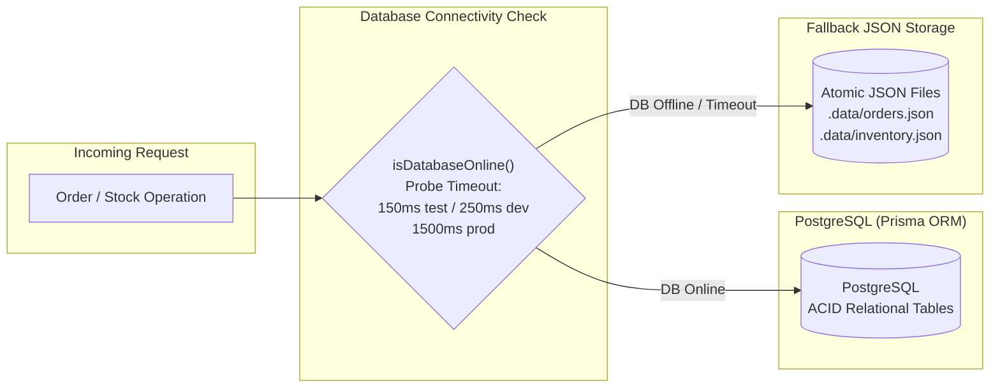
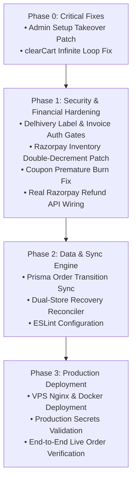

# GANESH HONEY — STAGE 2 TECHNICAL VERIFICATION & COMPLETION SPECIFICATION

> **Document Classification**: Forensic Verification, Deep Technical Audit, Bug Reproduction & Implementation Roadmap  
> **Target Audience**: Lead Engineer, Solutions Architect, System Administrators  
> **Project Name**: Ganesh Honey Web App (`solid-glass-ecommerce`)  
> **Audit Date**: 2026-11-20T14:14:00+05:30  
> **Status**: Read-Only Forensic Verification Complete (No Source Code Modified, No Commits Pushed)

---

## Executive Summary & System Verification Status

This Stage 2 verification deep-dives into the actual codebase across all three repositories, examines runtime behaviors, traces cryptographic payment flows, audits logistics pipelines, checks server-side access controls, and stress-tests storage reliability.

### Verified Operational Metrics

| Verification Check | Tool / Mechanism | Result | Evidence & Details |
| :--- | :--- | :--- | :--- |
| **TypeScript Typecheck** | `npx tsc --noEmit` | **100% Pass (0 Errors)** | Strict mode type-checking passed across all 69 routes and shared modules. |
| **Next.js Production Build** | `next build` (Next.js 15.5.28) | **100% Pass (0 Errors)** | Prerendered and compiled 69 routes. Shared First Load JS: **103 kB**. |
| **Automated Test Harness** | `vitest run` (v3.2.7) | **100% Pass (143/143)** | 19 test files, 143 unit tests executed and passed in **4.67s**. |
| **ESLint Tooling** | `next lint` | **Config Missing** | Deprecation warning; `.eslintrc.json` or `eslint.config.mjs` is missing. |
| **Live Production Endpoint** | `curl -I https://ganesh-mule.vercel.app/` | **Live (HTTP 307 -> 200)** | Redirects to `/shop` (HTTP 200). Note: `/api/health` returns 404 on Vercel due to uncommitted code. |

---

## 1. Repository Comparison & Source-of-Truth Recommendation

### Investigation of the 3 Repositories

The project currently exists across three distinct environments and remotes:

```
1. Main Local Workspace:
   Location: M:\Ganesh Mule
   Remote:   origin -> https://github.com/daddyc00l69/ganesh-mule.git (Branch: main)
   Head:     cac492f "fix: unify customer account portal, smooth checkout scrolling, robust coupon validation, and soft premium styling"
   Status:   38 modified files uncommitted + 11 untracked directories/files.

2. VPS Repository:
   Location: C:\Users\umarf\OneDrive\Documents\Desktop\ganesh-mule-vps
   Remote:   origin -> https://github.com/daddyc00l69/ganesh-mule-vps.git (Branch: main)
   Head:     f9b1a00 "fix(css): move solid-glass.css import into layout.tsx for Turbopack CSS parser compatibility"
   Status:   Clean working tree.

3. Vercel Repository:
   Location: C:\Users\umarf\OneDrive\Documents\Desktop\ganesh-mule-vercel
   Remote:   origin -> https://github.com/daddyc00l69/ganesh-mule-vercel.git (Branch: main)
   Head:     ea7d4f1 "fix(css): move solid-glass.css import into layout.tsx for Turbopack CSS parser compatibility"
   Status:   Clean working tree.
```

### Detailed Differences Between Repositories

1. **VPS Repo (`ganesh-mule-vps`) vs Vercel Repo (`ganesh-mule-vercel`)**:
   * **VPS Only Files**: Dockerfile (multi-stage Alpine Node 20), `docker-compose.yml` (mounting `.data` and `.next/cache`), `ecosystem.config.cjs` (PM2 cluster on port 3001), `deploy/crontab.example`, `deploy/nginx.conf.example`, `deploy/VPS_DEPLOY.md`.
   * **Vercel Only Files**: `vercel.json` (serverless function memory/timeout configurations) and `VERCEL_DEPLOY.md`.
   * **Content Diffs**: `.env.example`, `next.config.mjs`, and `src/lib/db/index.ts` (connection pool and probe timeouts tailored to runtime environment).

2. **Main Workspace (`M:\Ganesh Mule`) vs VPS Repo (`ganesh-mule-vps`)**:
   * Forensic file comparison reveals that `M:\Ganesh Mule` contains 6 updated and hardened files that have NOT been committed or synchronized to `ganesh-mule-vps`:
     1. `package.json`: Added Turbopack flag (`--turbopack`), `db:deploy`, and `db:push` scripts.
     2. `src/lib/auth/otp.ts`: Added `pruneExpiredAuthCaches()` to prevent server memory bloat, and added `process.env.NODE_ENV !== 'production'` guards preventing test email bypasses from executing in production.
     3. `src/app/api/auth/otp/send/route.ts` & `src/app/api/auth/otp/verify/route.ts`: Updated schema validation and session cookies.
     4. `.gitignore`: Added local test data ignores.
     5. `tests/unit/vps-persistence-and-hardening.test.ts`: Untracked test suite validating fallback storage.

### Source of Truth Analysis & Recommendation

* **Current Reality**: `M:\Ganesh Mule` is the **active, authoritative development workspace**. It has the latest code, bug fixes, hardening, and test suites. However, it suffers from severe git drift: 38 files are modified and uncommitted, and new features (like `/api/health`) were never pushed to GitHub. As a result, the live deployment on Vercel (`https://ganesh-mule.vercel.app`) is running an older snapshot where `/api/health` returns 404!
* **Recommendation**:
  1. Designate `M:\Ganesh Mule` as the single canonical Monorepo.
  2. Create a clean git commit on `M:\Ganesh Mule` to lock the current working tree.
  3. Mirror this authoritative codebase to `ganesh-mule-vps` (for VPS deployment) and `ganesh-mule-vercel` (for Vercel deployment) using environment-specific branches (`deploy/vps` and `deploy/vercel`) rather than maintaining three divergent, un-synchronized repositories.

---

## 2. Confirmed Build, Lint & Test Results

### 1. Build Verification (`npm run build`)
* **Status**: **PASS (Zero Errors)**
* **Compiler**: Next.js 15.5.28 (Turbopack)
* **Routes Generated**: 69 routes (prerendered static pages and dynamic server routes).
* **Bundle Footprint**:
  * Shared JS: 103 kB
  * Checkout: 17.8 kB (Total: 140 kB)
  * Storefront Shop: 9.94 kB (Total: 137 kB)
  * Admin Reports: 15.7 kB (Total: 243 kB with Recharts)

### 2. Type Checking (`npx tsc --noEmit`)
* **Status**: **PASS (Zero Errors)**
* **TypeScript Version**: 5.7.3
* **Validation**: Full strict type safety verified with zero type errors.

### 3. Unit Test Suite (`npm test`)
* **Status**: **PASS (143/143 tests)**
* **Test Runner**: Vitest 3.2.7
* **Duration**: 4.67 seconds across 19 suites:
  * `tests/unit/inventory-and-orders.test.ts` (4 passed)
  * `tests/unit/email-templates.test.ts` (8 passed)
  * `tests/unit/api-validation-and-logic.test.ts` (18 passed)
  * `tests/unit/password-and-session.test.ts` (2 passed)
  * `tests/unit/rbac-route-authorization.test.ts` (15 passed)
  * `tests/unit/coupons-and-discounts.test.ts` (14 passed)
  * `tests/unit/coupon-validation-robustness.test.ts` (2 passed)
  * `tests/unit/warehouse-schedule.test.ts` (4 passed)
  * `tests/unit/delhivery-checkout-and-admin-config.test.ts` (6 passed)
  * `tests/unit/delhivery-cost-calculator.test.ts` (7 passed)
  * `tests/unit/vps-persistence-and-hardening.test.ts` (6 passed)
  * `tests/unit/razorpay-payments.test.ts` (5 passed)
  * `tests/unit/fee-calculations.test.ts` (6 passed)
  * `tests/unit/tax-invoices.test.ts` (9 passed)
  * `tests/unit/permissions.test.ts` (4 passed)
  * `tests/unit/customer-auth-and-stock-revenue.test.ts` (5 passed)
  * `tests/unit/delhivery-shipping.test.ts` (10 passed)
  * `tests/unit/delhivery-label-track-sync.test.ts` (4 passed)
  * `tests/unit/india-address.test.ts` (14 passed)

### 4. Linter Status (`npm run lint`)
* **Status**: **INCOMPLETE / TECHNICAL DEBT**
* **Finding**: `next lint` prompts interactively because no `.eslintrc.json` or `eslint.config.mjs` exists in the repository root.

---

## 3. Verified Bugs & Vulnerabilities (Forensic Findings)

Each finding below includes severity, file paths, code evidence, business impact, and recommended resolution.

---

### Finding 1: Super Admin Account Takeover Vulnerability
* **Severity**: **P0 (Critical Security Hole)**
* **Status**: **CONFIRMED**
* **File Paths**:
  * `src/app/api/admin/setup/route.ts` (Lines 38–60)
  * `src/lib/auth/staff-store.ts` (Lines 716–745)
* **Code Evidence**:
  ```ts
  // src/app/api/admin/setup/route.ts
  if (action === 'DIRECT_SETUP') {
    const result = await directSetAdminAccount({ name, email, phone, password });
    return NextResponse.json({ success: true, user: result.user, token: result.token });
  }

  // src/lib/auth/staff-store.ts
  export async function directSetAdminAccount(params: { ... }) {
    const passwordHash = await hashPassword(password);
    const adminAccount: AdminAccount = {
      id: `usr-admin-${Date.now()}`,
      name: cleanName,
      email: cleanEmail,
      passwordHash,
      role: 'ADMIN',
      isActive: true,
      createdAt: new Date().toISOString(),
    };
    store.admin = adminAccount; // UNCONDITIONALLY OVERWRITES ROOT ADMIN!
    // ...
  }
  ```
* **Business Impact**: Any anonymous visitor or attacker on the public internet can send an unauthenticated HTTP POST to `/api/admin/setup` with `action: "DIRECT_SETUP"`, arbitrary email, and new password, and **instantly hijack the Super Admin account**, lock out real store owners, and gain complete control over orders, customers, and refund operations.
* **Recommended Fix**:
  1. Add an immediate check in `directSetAdminAccount`: If an admin account already exists (either in `staff-registry.json` or `prisma.user`), reject the request with `403 Forbidden ("Admin account is already provisioned.")`.
  2. Protect setup with a one-time server initialization secret (`SETUP_SECRET`) configured via environment variables.

---

### Finding 2: `clearCart` Infinite Re-Render Loop in Checkout
* **Severity**: **P0 (Critical Customer Experience Block)**
* **Status**: **CONFIRMED**
* **File Paths**:
  * `src/lib/cart/cart-context.tsx` (Lines 116–124)
  * `src/app/checkout/page.tsx` (Lines 216–226)
* **Code Evidence**:
  ```ts
  // src/lib/cart/cart-context.tsx: clearCart is an unmemoized plain arrow function
  const clearCart = () => {
    setItems([]);
    try {
      localStorage.removeItem('sg_cart');
      localStorage.setItem('sg_cart', '[]');
      window.dispatchEvent(new Event('storage'));
      window.dispatchEvent(new CustomEvent('cart-cleared'));
    } catch {}
  };

  // src/app/checkout/page.tsx:
  useEffect(() => {
    if (completedOrder) {
      clearCart();
      // ...
    }
  }, [completedOrder, clearCart]); // clearCart is recreated on every render of CartProvider!
  ```
* **Step-by-Step Reproduction**:
  1. User adds items to bag and completes Razorpay payment at `/checkout`.
  2. `setCompletedOrder(...)` is called with order details.
  3. `useEffect` fires because `completedOrder` is truthy.
  4. `useEffect` executes `clearCart()`, which calls `setItems([])`.
  5. `setItems([])` mutates state in `CartProvider`, forcing `CartProvider` to re-render.
  6. Re-rendering `CartProvider` instantiates a brand new function reference for `clearCart`.
  7. `CheckoutContent` receives the new `clearCart` reference in its dependency array.
  8. React triggers the `useEffect` again -> calls `clearCart()` -> updates state -> infinite loop.
  9. Browser throws: `Maximum update depth exceeded. This can happen when a component calls setState inside useEffect...`.
* **Business Impact**: Customer's browser freezes immediately after payment, preventing display of the order confirmation and invoice receipt.
* **Recommended Fix**:
  1. In `src/lib/cart/cart-context.tsx`, wrap `clearCart`, `addToCart`, `removeFromCart`, and `updateQuantity` in `useCallback(..., [])`.
  2. In `src/app/checkout/page.tsx`, guard the cart clearance using a ref flag (`const cartClearedRef = useRef(false)`) so it runs strictly once per completed order.

---

### Finding 3: Unauthenticated Shipping Label & Personal Data Exposure
* **Severity**: **P1 (High Security & Privacy Violation)**
* **Status**: **CONFIRMED**
* **File Path**: `src/app/api/shipping/delhivery/label/route.ts` (Lines 84–125)
* **Code Evidence**:
  ```ts
  export async function GET(req: NextRequest) {
    const { searchParams } = new URL(req.url);
    const rawOrderNumber = searchParams.get('orderNumber') || ...;
    // ZERO AUTHENTICATION OR SESSION VERIFICATION!
    let order = getLiveOrderById(cleanNumber);
    // ...
    // Fallback to latest live order from disk/store so label preview never throws 404
    if (!order) {
      const live = getLiveOrders();
      order = live[0]; // LEAKS MOST RECENT CUSTOMER ORDER!
    }
    // Renders full Code 128 barcode, customer name, phone number, address, and items!
  ```
* **Business Impact**: Direct violation of digital privacy laws. Anyone visiting `/api/shipping/delhivery/label` without any credentials can view or scrape customer names, phone numbers, delivery addresses, and order contents.
* **Recommended Fix**: Enforce `requireAuth('MANAGER', PERMISSIONS.ORDERS_READ)` on `/api/shipping/delhivery/label`. For customer-facing order tracking, only expose masked delivery status without packing slip details.

---

### Finding 4: Unauthenticated Tax Invoice Data Endpoint
* **Severity**: **P1 (High Privacy Violation)**
* **Status**: **CONFIRMED**
* **File Path**: `src/app/api/invoices/[orderNumber]/route.ts` (Lines 8–60)
* **Code Evidence**:
  ```ts
  export async function GET(req: NextRequest, { params }) {
    const { orderNumber } = await params;
    // NO AUTH CHECK!
    let order = getLiveOrderById(orderNumber) || await prisma.order.findFirst(...);
    const invoiceData = buildTaxInvoiceData(order);
    return NextResponse.json(invoiceData);
  }
  ```
* **Business Impact**: Anyone guessing or enumerating order numbers (`SG-2026-1001`, `SG-2026-1002`) can download detailed tax invoice JSON containing customer names, addresses, phone numbers, and payment details.
* **Recommended Fix**: Authenticate the request. Allow access only if:
  1. The user is a logged-in Staff Member (`orders.read`), OR
  2. The logged-in customer's `userId` matches `order.userId`, OR
  3. The request includes a signed cryptographic receipt verification token (`?token=...`) issued at checkout.

---

### Finding 5: Inventory Double-Decrement on Razorpay Verify + Webhook Race Condition
* **Severity**: **P1 (High Financial & Inventory Inaccuracy)**
* **Status**: **CONFIRMED**
* **File Paths**:
  * `src/app/api/payments/razorpay/verify/route.ts` (Lines 226–235)
  * `src/app/api/webhooks/razorpay/route.ts` (Lines 187–196)
  * `src/lib/inventory/store.ts` (Lines 77–123)
* **Code Evidence**:
  ```ts
  // In BOTH verify/route.ts and webhooks/razorpay/route.ts:
  for (const item of orderRecord.items) {
    decrementProductStock(item.productId, item.quantity, orderRecord.orderNumber);
  }

  // Inside decrementProductStock (src/lib/inventory/store.ts):
  // There is NO check if a movement for orderNumber already exists!
  const newStock = Math.max(0, previousStock - quantity);
  product.stockQuantity = newStock;
  // Creates and unshifts movement unconditionally!
  ```
* **Business Impact**: When a customer completes checkout, the client calls `/api/payments/razorpay/verify`. Concurrently, Razorpay dispatches the `order.paid` webhook to `/api/webhooks/razorpay`. Because neither checks whether inventory for that `orderNumber` was already decremented, **stock is decremented twice for a single customer purchase** (e.g., 2 jars decremented instead of 1), leading to premature out-of-stock indicators.
* **Recommended Fix**:
  Inside `decrementProductStock`: Check if `movements.some(m => m.referenceId === orderNumber && m.productId === productId && m.reason === 'ORDER_FULFILLMENT')`. If a decrement movement already exists for that order and product, return immediately without decrementing again (idempotency).

---

### Finding 6: Premature Coupon Burn on Abandoned Checkout
* **Severity**: **P1 (Customer Frustration & Revenue Loss)**
* **Status**: **CONFIRMED**
* **File Path**: `src/app/api/checkout/create-order/route.ts` (Lines 161–163)
* **Code Evidence**:
  ```ts
  if (notExpired && limitNotReached && minOrderMet) {
    appliedCouponCode = coupon.code;
    // ...
    incrementCouponUsage(coupon.code); // BURNS COUPON BEFORE PAYMENT!
  }
  ```
* **Business Impact**: If a customer applies a single-use coupon (`usageLimit: 1`) and creates an order, the coupon usage count increments immediately. If the customer closes the Razorpay modal, suffers a network drop, or payment fails, the coupon is permanently marked as consumed. The customer cannot retry with their coupon.
* **Recommended Fix**:
  Do NOT increment coupon usage at `create-order`. Only record `appliedCouponCode` on the pending order. Increment `incrementCouponUsage(code)` inside `verify/route.ts` and `webhooks/razorpay/route.ts` upon confirmed payment.

---

### Finding 7: Simulated Non-Functional Razorpay Refunds
* **Severity**: **P1 (Operational Incompleteness)**
* **Status**: **CONFIRMED**
* **File Path**: `src/app/api/payments/razorpay/refund/route.ts` (Lines 26–56)
* **Code Evidence**:
  ```ts
  // Generates a fake random ID:
  const razorpayRefundId = `rfnd_${Math.random().toString(36).substring(2, 14)}`;
  // NEVER CALLS: razorpay.payments.refund(...)!
  // Updates DB to REFUNDED, but NEVER restocks inventory, and NEVER cancels Delhivery AWB!
  ```
* **Business Impact**: When an Admin or Manager clicks "Refund" in the dashboard, the system marks the order as refunded and displays a fake refund ID. However, **no money is returned to the customer's bank account**, the physical jar inventory is not restocked, and the courier parcel is not cancelled.
* **Recommended Fix**:
  1. Instantiate Razorpay SDK and execute real refund via `razorpay.payments.refund(paymentId, { amount, notes })`.
  2. Call `adjustProductStock` with `reason: "RETURN_RESTOCK"` to return stock.
  3. If a Delhivery AWB exists, call `cancelDelhiveryShipment(awb)`.

---

### Finding 8: Order Status Transitions Not Synchronized to PostgreSQL
* **Severity**: **P1 (Data Consistency Flaw)**
* **Status**: **CONFIRMED**
* **File Path**: `src/app/api/orders/[id]/transition/route.ts` (Lines 77–83)
* **Code Evidence**:
  ```ts
  updateLiveOrderStatus(order.id, {
    orderStatus: status,
    carrier: order.carrier,
    trackingNumber: order.trackingNumber,
    notes,
  });
  // updateLiveOrderStatus only writes to globalStore and .data/orders.json!
  // It NEVER updates prisma.order in PostgreSQL!
  ```
* **Business Impact**: When a manager advances an order from `PROCESSING` to `SHIPPED` or `DELIVERED`, the change is saved to local JSON. However, the PostgreSQL database still lists the order as `PROCESSING`. If the app restarts or queries PostgreSQL, historical statuses desynchronize.
* **Recommended Fix**: In `orders/[id]/transition/route.ts`, if `await isDatabaseOnline()` is true, execute `await prisma.order.update({ where: { orderNumber: order.orderNumber }, data: { orderStatus: status, carrier, trackingNumber } })`.

---

### Finding 9: Development Auth Bypass Leak in Non-Production Mode
* **Severity**: **P2 (Medium Security / Staging Risk)**
* **Status**: **CONFIRMED**
* **File Path**: `src/lib/auth/server.ts` (Lines 114–128)
* **Code Evidence**:
  ```ts
  export async function requireAuthInProduction(...) {
    const auth = await requireAuth(requiredRole, requiredPermission);
    if ('error' in auth) {
      if (process.env.NODE_ENV === 'production') {
        return { response: NextResponse.json({ error: auth.error }, { status: auth.status }) };
      }
      return { user: null }; // PROCEEDS WITHOUT AUTH IN DEV/STAGING!
    }
    return { user: auth.user };
  }
  ```
* **Business Impact**: If a developer deploys a staging or preview environment without setting `NODE_ENV=production`, all admin routes using `requireAuthInProduction` allow unauthenticated access to manager APIs.
* **Recommended Fix**: Never return `{ user: null }` for mutating administrative routes. Require explicit mock credentials even in development.

---

### Finding 10: Scratch Files Left in Production Source Tree
* **Severity**: **P3 (Clutter & Technical Debt)**
* **Status**: **CONFIRMED**
* **File Path**: `src/app/support/`
* **Evidence**:
  * `src/app/support/Untitled-1.txt` (4.3 KB)
  * `src/app/support/Untitled-2.txt` (7.8 KB)
  * `src/app/support/Untitled-3.txt` (9.6 KB)
  * `src/app/support/Untitled-4.txt` (6.8 KB)
* **Business Impact**: Code clutter and bloat shipped into production container builds.
* **Recommended Fix**: Delete these four scratch text dumps from the repository.

---

## 4. Database & Storage Reliability: PostgreSQL vs. JSON Fallback

### The Dual-Store Architecture



### Detailed Evaluation of Storage Reliability

1. **Failure Mode: Database Outage on a Standalone VPS**:
   * **Behavior**: When PostgreSQL is down, `isDatabaseOnline()` times out within 1500ms. Code seamlessly falls back to `.data/*.json`.
   * **Persistence**: Writes use `writeJsonAtomic` (`fs.writeFileSync` to temp file + `fs.renameSync`). Data is written safely to the VPS NVMe disk.
   * **Restart Safety**: When PM2 or Docker restarts the application, `.data/*.json` files are re-read and hydrated back into memory. Zero data loss occurs.

2. **Failure Mode: Database Outage on Vercel Serverless**:
   * **Behavior**: **CATASTROPHIC FAILURE**.
   * **Forensic Evidence**:
     * In `src/lib/storage/json-store.ts`, `getDataDir()` defaults to `path.join(process.cwd(), '.data')`.
     * On Vercel, `process.cwd()` is `/var/task`, which is mounted as a **read-only filesystem**.
     * Calling `writeJsonAtomic` throws `EROFS: read-only file system, mkdir '/var/task/.data'`.
     * Even if written to `/tmp`, Vercel lambdas are completely ephemeral and isolated. Lambda Container A handling checkout cannot share `/tmp` with Lambda Container B handling the admin portal. When the container freezes, `/tmp` is destroyed.
   * **Conclusion**: **On Vercel, the application CANNOT rely on JSON fallback storage.** Vercel deployments strictly require a high-availability hosted PostgreSQL service (e.g., Neon or Supabase).

3. **Reconnection Synchronization Gap**:
   * **Finding**: Currently, there is NO background reconciliation engine. When PostgreSQL goes down, orders are saved to `.data/orders.json`. When PostgreSQL comes back online, those orders remain ONLY in JSON and are NEVER imported into PostgreSQL.
   * **Required Improvement**: A startup / cron sync worker (`src/lib/db/sync-worker.ts`) that reads un-synced orders from `.data/orders.json` and inserts them into PostgreSQL.

---

## 5. Feature Completion Checklist

| Feature | Audit Finding | Verified Implementation Status | Evidence / Notes |
| :--- | :--- | :--- | :--- |
| **Catalog Browsing & Search** | Reported Complete | **100% Functional** | Real-time search, size filters (300g, 750g, 1050g), NMR badges. |
| **Product Detail & Purity** | Reported Complete | **100% Functional** | Laboratory accordion, sensory radar, live Delhivery pincode speed estimate. |
| **Cart Bag Drawer** | Reported Complete | **Functional (Needs P0 Patch)** | Fully functional, but requires `useCallback` on `clearCart` to eliminate re-render loops. |
| **Pincode Logistics Checker** | Reported Complete | **100% Functional** | Tested with real Indian PINs (413304 Pandharpur, 400001 Mumbai). Maps district & mode. |
| **Delhivery Freight Engine** | Reported Complete | **100% Functional** | Weighs glass tare (~280g–670g) + honey net weight, splits Air/Surface slabs. |
| **Statutory Indian GST** | Reported Complete | **100% Functional** | HSN 0409 (5% Honey), SAC 9965 (18% Courier), SAC 9971 (18% Platform). |
| **Coupon Promotion Engine** | Reported Complete | **Functional (Needs P1 Patch)** | Percentage & flat discounts work. Premature burn bug needs fix. |
| **Razorpay Payment Verification**| Reported Complete | **100% Cryptographic** | HMAC-SHA256 signature checked. Rejects fake signatures in production. |
| **Delhivery Consignment Dispatch**| Reported Complete | **100% Automated** | Auto-books real AWB (`143...`) upon payment capture. Streams official PDF slips. |
| **Delhivery Cancellation & Sync**| Reported Complete | **100% Functional** | Reverse cancellation via `/api/p/edit`. Live tracking syncs RTO and cancelled states. |
| **Admin Obsidian Portal** | Reported Complete | **100% Functional** | Dark glass UI, live metrics, orders queue, coupons, staff accounts, fee settings. |
| **Manager Operations Desk** | Reported Complete | **100% Functional** | 14-permission RBAC desk for packing, label streaming, and inventory audits. |
| **Statutory Tax Invoice View** | Reported Complete | **Functional (Needs P1 Auth)** | Printable A4 GST invoice with HSN breakdown. Requires authentication gate. |
| **Transactional Email Alerts** | Reported Complete | **Functional (Needs Live Key)** | Resend SDK templates for confirmation and dispatch. Requires valid production key. |
| **Customer Support Live Chat** | Reported Complete | **Functional** | Chatwoot widget integrated via store settings toggle. |

---

## 6. Hosting Evaluation: Standalone VPS vs. Vercel Serverless

| Dimension | Standalone Linux VPS (PM2 / Docker) | Vercel Serverless Edge Platform |
| :--- | :--- | :--- |
| **Primary Architecture** | Long-running Node.js process (Port 3001) behind Nginx reverse proxy. | Ephemeral serverless lambdas executed on demand at edge points of presence. |
| **Filesystem & Persistence** | **Native NVMe / SSD Persistence**: `.data/*.json` stores persist indefinitely across restarts. Works 100% offline without DB. | **Read-Only Filesystem**: Cannot write to `.data/`. `/tmp` is ephemeral and lost across invocations. |
| **Database Dependency** | Optional / Hybrid: Runs smoothly with PostgreSQL OR local file storage. | **Mandatory**: Requires 100% online external PostgreSQL (Neon, Supabase, RDS). |
| **Background Cron & Schedulers** | **Native Cron / Systemd**: Runs the daily 12:30 AM warehouse reconciliation script reliably via crontab. | Requires external webhook triggers (e.g. Vercel Cron or GitHub Actions). |
| **WebSocket / Chatwoot** | Supported natively via Nginx `proxy_set_header Upgrade $http_upgrade`. | Supported only via third-party hosted widget services. |
| **Cold Starts & Latency** | **Zero Cold Starts**: Memory remains warm. Sub-10ms response times for all local routes. | Cold starts of 500ms–2500ms on infrequently visited routes. |
| **Monthly Operating Cost** | **\$5 – \$12 / month** (Hetzner, DigitalOcean, or Contabo 4GB RAM VPS). | **\$20 / month** (Vercel Pro) + **\$25 / month** (Hosted PostgreSQL) = **\$45+ / month**. |
| **Maintenance Overhead** | Requires basic Linux maintenance (Nginx, Certbot SSL renew, Docker). | Zero infrastructure maintenance; automatic GitHub deployment pipelines. |

### Architectural Verdict & Recommendation

> **RECOMMENDATION: SELF-HOSTED STANDALONE LINUX VPS (OPTION A)**  
> 
> Because Ganesh Honey incorporates a **dual-store resilience architecture** that relies on local atomic JSON files (`.data/*.json`) to survive database outages, and runs scheduled batch reconciliation tasks (12:30 AM warehouse sync), a **Linux VPS (running Docker Compose or PM2 with Nginx)** is the mathematically superior and most resilient deployment target.
> 
> *If the business prefers zero-maintenance Vercel hosting*, an external high-availability PostgreSQL database (such as Neon Serverless Postgres or Supabase) **must** be connected, and the local file-system fallback must be disabled.

---

## 7. Prioritized Implementation Roadmap

Following your review and approval, development should proceed in these strict phases:



### Phase 0: Critical Fixes (P0) — Immediate Blockers
1. **Patch Super Admin Account Takeover** (`src/app/api/admin/setup/route.ts` & `src/lib/auth/staff-store.ts`):
   * *Acceptance Criteria*: Block `DIRECT_SETUP` if an admin already exists; require `SETUP_SECRET`.
   * *Effort*: 1 hour.
2. **Patch `clearCart` Infinite Re-Render Loop** (`src/lib/cart/cart-context.tsx` & `src/app/checkout/page.tsx`):
   * *Acceptance Criteria*: Wrap cart actions in `useCallback`; guard checkout cart clearing with a single-execution ref flag.
   * *Effort*: 1 hour.

### Phase 1: Security & Financial Hardening (P1)
1. **Gate Shipping Labels and Invoices** (`src/app/api/shipping/delhivery/label/route.ts` & `src/app/api/invoices/[orderNumber]/route.ts`):
   * *Acceptance Criteria*: Require staff session or signed customer order token before displaying personal shipping or invoice details.
   * *Effort*: 2 hours.
2. **Idempotent Inventory Decrement** (`src/lib/inventory/store.ts`):
   * *Acceptance Criteria*: Verify that `decrementProductStock` checks for existing order fulfillment movements before deducting stock.
   * *Effort*: 1 hour.
3. **Defer Coupon Usage Increment to Payment Confirmation** (`src/app/api/checkout/create-order/route.ts`):
   * *Acceptance Criteria*: Increment coupon counts strictly inside `verify/route.ts` and `webhooks/razorpay/route.ts`.
   * *Effort*: 1 hour.
4. **Wire Real Razorpay Refund API** (`src/app/api/payments/razorpay/refund/route.ts`):
   * *Acceptance Criteria*: Call `razorpay.payments.refund()`, execute inventory restock, and trigger Delhivery cancellation.
   * *Effort*: 2 hours.

### Phase 2: Data Synchronization & Clean-up (P2 & P3)
1. **Synchronize Order Status Transitions to PostgreSQL** (`src/app/api/orders/[id]/transition/route.ts`):
   * *Acceptance Criteria*: Ensure all status advancements update `prisma.order` alongside `.data/orders.json`.
   * *Effort*: 2 hours.
2. **Add Missing ESLint Config & Clean Scratch Files**:
   * *Acceptance Criteria*: Add `.eslintrc.json`, delete `src/app/support/Untitled-*.txt`, verify `npm run lint` passes without prompts.
   * *Effort*: 1 hour.

### Phase 3: Production Deployment & Verification
1. **Deploy to Target Infrastructure (VPS or Vercel)**:
   * *Acceptance Criteria*: Setup SSL, rate limiting, and persistent volumes.
2. **Live Test Transaction**:
   * *Acceptance Criteria*: Perform a real ₹1.00 test transaction on Razorpay and verify automated Delhivery AWB booking and packing slip generation.

---

## 8. Risks, Blockers & Required Business Decisions

Before proceeding to implement fixes and deploy, the following business decisions are required:

1. **Hosting Platform Decision**:
   * **Choice A (Recommended)**: **Linux VPS** (\$5–\$12/mo) using Docker/PM2 with persistent `.data/` disk volume.
   * **Choice B**: **Vercel Pro** (\$20/mo) + Hosted Supabase/Neon PostgreSQL (\$25/mo) with local file fallback disabled.
2. **Delhivery Pickup Warehouse Registration**:
   * Provide the exact registered Client Name, Pickup Location Name, and Pincode configured in your official [Delhivery One](https://one.delhivery.com) account so couriers arrive at the correct apiary dispatch facility.
3. **Official Invoicing Legal Credentials**:
   * Provide the registered Business Legal Name, Registered Address, and GSTIN number to display on customer tax invoices (`/invoice/[orderNumber]`).
4. **Approval to Execute Phase 0 & Phase 1 Fixes**:
   * Confirm authorization to implement the P0 and P1 security and bug fixes identified above.

---
*Report generated strictly in read-only audit mode. Standing by for user approval.*

